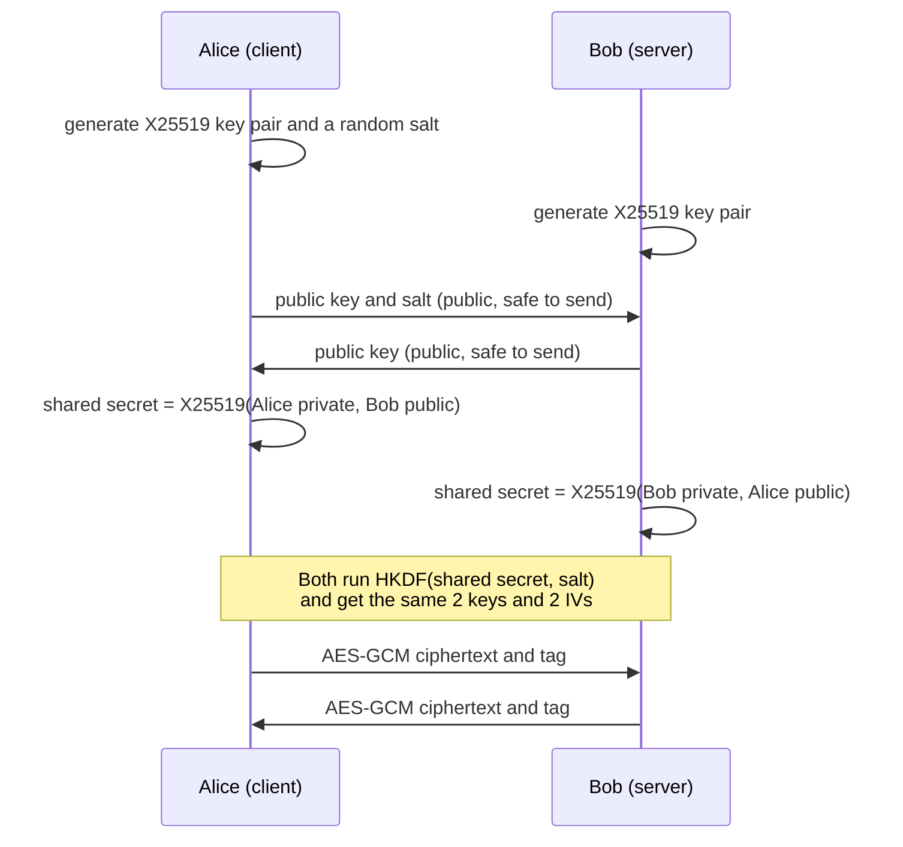
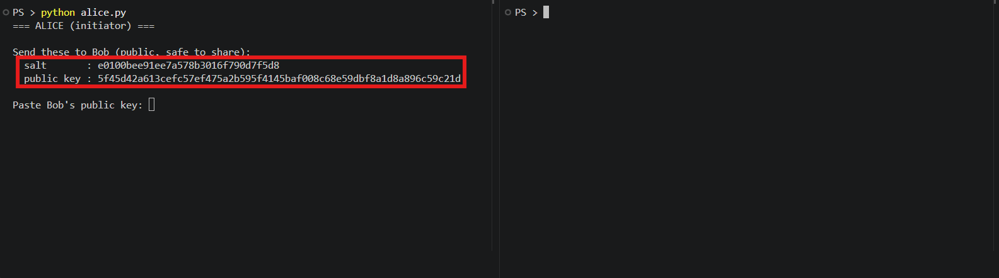
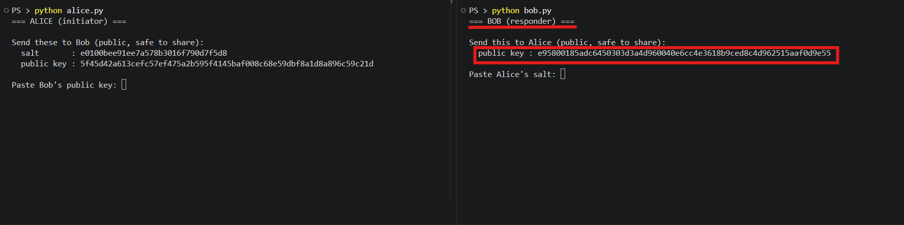
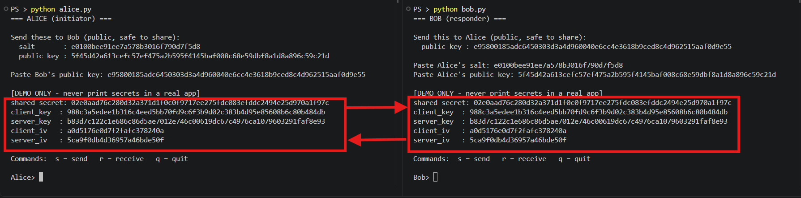
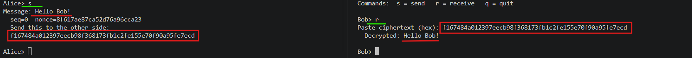
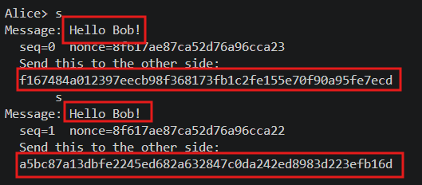
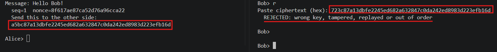
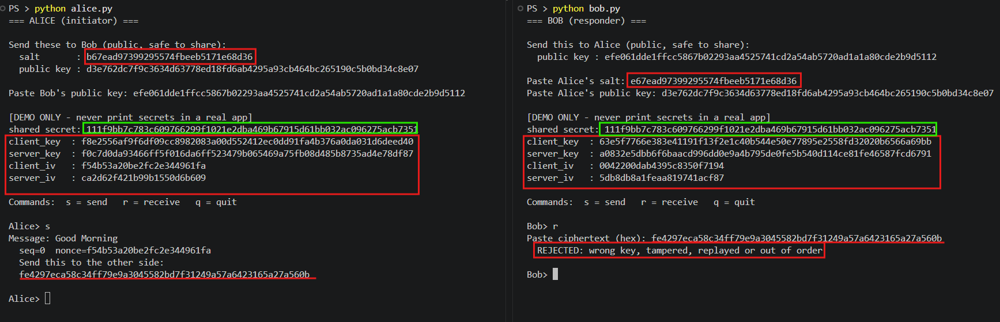

# Mini TLS 1.3

**How a secure channel is built from nothing: key exchange, key derivation and authenticated encryption, in about 150 lines of Python.**

This project re-creates the core cryptographic idea behind TLS 1.3 (and Signal, WireGuard, and similar protocols) so you can see every step with your own eyes: two strangers agree on a secret over an open channel, turn it into keys, and exchange encrypted messages.

> **Educational project.** It is a simplified model, not an implementation of TLS. Do not use it to protect real data. See [Limitations](#limitations).

| Step              | Algorithm         | What it does                                               |
| ----------------- | ----------------- | ---------------------------------------------------------- |
| 1. Key exchange   | **X25519** (ECDH) | Both sides compute the same secret without ever sending it |
| 2. Key derivation | **HKDF-SHA256**   | Turns that one secret into separate keys and IVs           |
| 3. Encryption     | **AES-256-GCM**   | Encrypts every message and detects tampering               |

---

## Table of contents

1. [How it works](#how-it-works)
2. [Project structure](#project-structure)
3. [Installation](#installation)
4. [Usage](#usage)
5. [Experiments](#experiments)
6. [What is sent and what is not](#what-is-sent-and-what-is-not)
7. [How this compares to real TLS 1.3](#how-this-compares-to-real-tls-13)
8. [Glossary](#glossary)

---

## How it works



### Phase 1: Key exchange (X25519)

Each side generates a key pair. They swap **only the public keys**. Each side then combines its **own private key** with the **other side's public key** and gets the same 32-byte shared secret. An eavesdropper sees both public keys but cannot compute the secret.

### Phase 2: Key derivation (HKDF)

The raw shared secret is strong but is only one value, and it is not uniformly random. HKDF cleans it up and expands it into four independent values, using a different label for each:

```
shared secret + salt
      |
      +-- HKDF("client key", 32 bytes) --> client_key   (Alice -> Bob)
      +-- HKDF("server key", 32 bytes) --> server_key   (Bob -> Alice)
      +-- HKDF("client iv",  12 bytes) --> client_iv
      +-- HKDF("server iv",  12 bytes) --> server_iv
```

One key and one IV **per direction**, so the same (key, nonce) pair is never used by both sides.

### Phase 3: Encryption (AES-256-GCM)

Every message is encrypted with the key of its direction. The nonce is **computed**, never sent:

```
nonce = IV XOR sequence number        (0, 1, 2, 3, ...)
```

- The IV is fixed for the session; the counter changes with every message, so every nonce is unique.
- GCM adds a 16-byte **authentication tag**. If even one bit of the message changes, decryption fails.
- Ciphertext length = message length + 16 bytes (the tag).

---

## Project structure

```
mini-tls13/
├── README.md
├── requirements.txt
├── .gitignore
├── crypto_utils.py     # X25519, HKDF, AES-GCM, Session, chat loop
├── alice.py            # initiator (client): generates the salt
└── bob.py              # responder (server): receives the salt
```

| File              | Role                                                                                                                                    |
| ----------------- | --------------------------------------------------------------------------------------------------------------------------------------- |
| `crypto_utils.py` | All the cryptography. Key pairs, `derive_session_keys`, `make_nonce`, and the `Session` class that holds keys, IVs and message counters |
| `alice.py`        | Starts the exchange, picks the random salt, takes the **client** role                                                                   |
| `bob.py`          | Answers the exchange, takes the **server** role                                                                                         |

---

## Installation

Requires **Python 3.9+**.

```bash
git clone https://github.com/schakibb/Mini-TLS-1.3
cd mini-tls13

pip install -r requirements.txt
```

---

## Usage

Open **two terminals** in the project folder and follow the steps in order.

| #   | Terminal | Action                                                            |
| --- | -------- | ----------------------------------------------------------------- |
| 1   | A        | `python alice.py`. Copy the **salt** and **public key** it prints |
| 2   | B        | `python bob.py`. Copy Bob's **public key** it prints              |
| 3   | B        | Paste Alice's **salt**, then Alice's **public key**               |
| 4   | A        | Paste Bob's **public key**                                        |
| 5   | A and B  | Compare the printed values (see below)                            |
| 6   | A        | Type `s`, write a message, copy the hex it prints                 |
| 7   | B        | Type `r`, paste the hex. Bob sees the message                     |

### Step 1: Alice starts



> _Screenshot 1: Alice's terminal showing the salt and her public key._

### Step 2: Bob starts



> _Screenshot 2: Bob's terminal showing his public key and the prompts for Alice's salt and public key._

### Step 3: Both sides derive the same keys

Each terminal prints the shared secret and the four derived values. They **must be identical** on both sides:

| Value         | Alice | Bob  |
| ------------- | ----- | ---- |
| shared secret | same  | same |
| client_key    | same  | same |
| server_key    | same  | same |
| client_iv     | same  | same |
| server_iv     | same  | same |



> _Screenshot 3: Alice and Bob side by side with the five matching values highlighted._

> The demo prints secrets only so you can verify them. A real application must never do this.

### Step 4: Send an encrypted message

In Alice's terminal:

```
Alice> s
Message: Hello Bob!
  seq=0  nonce=...
  Send this to the other side:
  <ciphertext + tag in hex>
```

In Bob's terminal:

```
Bob> r
Paste ciphertext (hex): <paste>
  Decrypted: Hello Bob!
```



> _Screenshot 4: Alice sending "Hello Bob!" and Bob decrypting it, side by side._

---

## Experiments

Try these to see why each part of the design exists.

### 1. Same message twice gives different ciphertext

Send `Hello Bob!` two times from Alice. The ciphertext and nonce are different each time, because the sequence number changed (`seq=0`, then `seq=1`). Bob must receive them in order.



> _Screenshot 5: Alice's terminal showing two sends of the same text, with different seq, nonce and ciphertext._

### 2. Tampering is detected

Before pasting a ciphertext into Bob, **change one hex character** (for example `a` to `b`). Do not delete characters.

Result: `REJECTED: wrong key, tampered, replayed or out of order`. The GCM tag no longer matches.



> _Screenshot 6: Bob rejecting a modified ciphertext._

### 3. Replay is rejected

Paste a ciphertext that Bob **already accepted** a second time.

Result: rejected. Bob's counter moved on, so he now expects a different nonce, and the old message no longer verifies.


> _Screenshot 7: Bob accepting a message once, then rejecting the same message pasted again._

### 4. A different salt gives different keys

Run Bob again and paste Alice's salt with **one character changed**.

Result: the **shared secret is the same**, but `client_key`, `server_key` and the IVs are **different**, so every message is rejected. The salt is not secret, but both sides must use the same one.



> _Screenshot 8 (optional): Alice and Bob side by side. The shared secret matches, the derived keys do not._

### 5. Out-of-order messages fail

Send two messages from Alice, then paste the **second** one into Bob first. It is rejected, because Bob expects sequence number 0. Both sides must keep their counters in sync (TLS relies on TCP to guarantee the order).

---

## What is sent and what is not

| Value                | Sent?                    | Why                                       |
| -------------------- | ------------------------ | ----------------------------------------- |
| Public keys          | Yes, once                | Each side needs the other's for X25519    |
| Salt                 | Yes, once (Alice to Bob) | Both sides must use the same salt in HKDF |
| **Ciphertext + tag** | **Yes, every message**   | The encrypted data                        |
| Private keys         | Never                    | They never leave their owner              |
| Shared secret        | Never                    | Each side computes it locally             |
| Keys and IVs         | Never                    | Each side derives them with HKDF          |
| **Nonce**            | **Never**                | Each side computes `IV XOR seq` locally   |

---

## How this compares to real TLS 1.3

| Concept            | This project                         | Real TLS 1.3                                                                    |
| ------------------ | ------------------------------------ | ------------------------------------------------------------------------------- |
| Key exchange       | X25519, new keys every run           | X25519 (or P-256), new keys every connection                                    |
| Key derivation     | HKDF-SHA256 with simple labels       | HKDF with a labeled, **chained key schedule** (early, handshake, master secret) |
| Salt               | Random, sent by the initiator        | The previous secret in the chain acts as the salt                               |
| Keys per direction | 1 key + 1 IV per direction           | Separate **handshake keys** and **application keys**, each per direction        |
| Transcript hash    | Not used                             | Mixed into the key derivation, so tampering with the handshake breaks the keys  |
| Nonce              | `IV XOR sequence number` (same idea) | `IV XOR sequence number`                                                        |
| Cipher             | AES-256-GCM                          | AES-128-GCM, AES-256-GCM, or ChaCha20-Poly1305                                  |
| **Authentication** | **None**                             | **Server certificate and signature**                                            |
| Transport          | Copy and paste                       | TCP and the TLS record layer                                                    |

---

## Glossary

| Term              | Meaning                                                                              |
| ----------------- | ------------------------------------------------------------------------------------ |
| **Key exchange**  | Two parties agree on a shared secret over an open channel                            |
| **KDF**           | Key Derivation Function: turns a secret into one or more keys                        |
| **Salt**          | Public random value that makes key derivation unique per session                     |
| **IV / nonce**    | Public value that makes each encryption unique. Never reuse a (key, nonce) pair      |
| **AEAD**          | Authenticated Encryption with Associated Data (encryption and integrity in one step) |
| **Tag**           | The 16-byte value GCM adds to detect tampering                                       |
| **Replay attack** | Re-sending a captured valid message                                                  |
| **MITM**          | Man-in-the-middle: an attacker relaying and altering traffic between two parties     |

---
